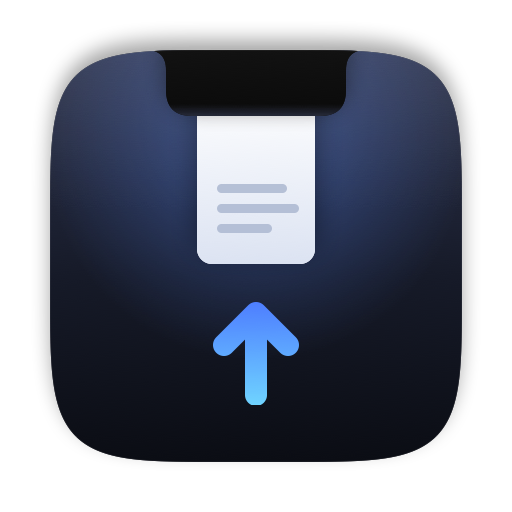

<p align="center">
  
</p>

# DropNotch

A file shelf and music controls that live right in your Mac's notch. Drag a file to the top of the screen, drop it into the notch, and drag it out again later, into any app or folder. While music plays, the notch shows what's on and lets you control Spotify or Apple Music without switching apps.

Free, open source and ad-free. Requires macOS 14 or later.

## Features

### Shelf

- **Drop and drag out:** Drag a file anywhere on screen and the notch expands with "Drop here". Drop it in, and later hover over the notch to drag the file out again, into any app or folder.
- **Multiple selection:** Click to select, ⌘-click to add or remove items, ⇧-click to select a range. Dragging a selected item takes the whole selection along. Once the shelf holds more than one item, a chip in its corner drags out all files at once.
- **File promises:** Mail attachments, photos from Photos and images from Safari, which only get written to disk when dropped, are received as real files.
- **Links and text:** Dropped web links are saved as `.webloc` files named after the page title or host. Dropped text becomes a `.txt` file, and browser images that aren't real files are saved as PNG.
- **Copy or link:** By default the shelf only links to your files (bookmarks keep track of them even after they're moved or renamed). Turn on **Copy Files Instead of Linking** to keep a copy, so the item stays even if the original is deleted.
- **Remove after dragging out:** Optionally remove items from the shelf once you've dropped them somewhere else. Copies are moved to the Trash, never deleted permanently; originals are never touched.
- **Copy progress:** In copy mode, files and folders are copied in the background, and incoming file promises are received the same way. A placeholder with a spinner sits in the shelf until they're done.
- **Context menu:** Open, Show in Finder, Send via AirDrop and Remove from Shelf. Double-click opens a file; hovering shows a remove button.
- **Persistence:** The shelf survives restarts. It is stored in `~/Library/Application Support/DropNotch`.

### Music

- Works with **Spotify** and **Apple Music**. When both are running, DropNotch controls the one that's playing.
- Artwork, title and artist, a seek bar (click or drag to seek), play/pause, previous and next track, and a volume slider.
- **Live activity:** While music is playing, the closed notch shows the artwork and an animated equalizer next to the camera. You can turn this off in the menu.

### Notch and controls

- **Global shortcut ⌃⌥D** opens and closes the notch. **Esc** closes it, and so does a click outside. A pin button keeps the notch open.
- **Notch position:** Show the notch on the display with the notch, or let it follow the mouse to whichever screen the pointer is on.
- **Works on Macs without a notch:** An invisible zone in the middle of the menu bar acts as the notch.
- **Launch at login** from the menu bar icon.
- **Energy-efficient tracking:** The mouse is tracked with event monitors. A timer only runs while it's actually needed (during hover and close delays, drags and while the notch is open), so nothing runs while the mouse rests elsewhere.

## Download & Installation

1. Download the latest `DropNotch-<version>.zip` from [Releases](https://github.com/MartinGeltl21/DropNotch/releases/latest) and unzip it.
2. Move `DropNotch.app` to `/Applications`.
3. The app is ad-hoc signed and **not notarized**, so Gatekeeper blocks it on first launch. To open it anyway, do one of the following:
   - Right-click `DropNotch.app` and choose **Open**.
   - On macOS 15 and later: try to open the app once, then go to **System Settings → Privacy & Security** and click **Open Anyway**.
   - Remove the quarantine flag in Terminal:

     ```sh
     xattr -dr com.apple.quarantine /Applications/DropNotch.app
     ```

**Requirements:** macOS 14 (Sonoma) or later. The release is a universal binary for Apple Silicon and Intel Macs.

## Permissions

The first time you control Spotify or Music, macOS asks whether DropNotch may control that app (Automation). Allow it. If you denied it, the notch shows a button that opens the right page in System Settings.

With ad-hoc signing, macOS asks again after **every** rebuild, because the code signature changes. To avoid that when building yourself, sign with a development certificate:

```sh
SIGN_IDENTITY="Apple Development: Your Name (XXXX)" scripts/build-app.sh --install
```

## Building from source

You need Xcode or the Command Line Tools, and macOS 14 or later.

```sh
scripts/build-app.sh             # release build into ./build
scripts/build-app.sh --run       # build and launch
scripts/build-app.sh --install   # build and copy to /Applications (needed for Launch at Login)
UNIVERSAL=1 VERSION=0.2.0 scripts/build-app.sh --zip   # universal build + build/DropNotch-0.2.0.zip
```

Run the tests:

```sh
swift test
```

Regenerate the app icon (`Resources/AppIcon.icns` and `docs/icon.png`):

```sh
swift scripts/make-icon.swift
```

To work in Xcode, open the package:

```sh
open Package.swift
```

## Releasing

Pushing a version tag triggers the release workflow, which builds a universal app, signs it ad-hoc, zips it and publishes a GitHub release:

```sh
git tag v0.2.0 && git push origin v0.2.0
```

Tags with a suffix (e.g. `v0.3.0-beta.1`) are published as pre-releases.

## How it works

| Part | File | Technique |
|---|---|---|
| Window | `NotchPanel.swift` | Borderless, non-activating `NSPanel` above the menu bar, visible on all Spaces. While the notch is closed, it lets clicks pass through (`ignoresMouseEvents`). |
| Drop target | `NotchPanel.swift` (`NotchHostingView`) | AppKit drag destination instead of SwiftUI's `.onDrop`, because that's the only way file promises arrive. |
| Hover and drag | `NotchViewModel.swift` | Global and local `NSEvent` monitors, plus a 30 Hz timer only while needed. A system-wide file drag is detected by the `changeCount` of the drag pasteboard. |
| Notch size | `NotchViewModel.updateScreen()` | The display's `safeAreaInsets.top` and `auxiliaryTopLeftArea`/`auxiliaryTopRightArea`. |
| Shelf | `ShelfStore.swift`, `ShelfView.swift` | JSON index plus bookmarks in `~/Library/Application Support/DropNotch`, `NSFilePromiseReceiver` for file promises, Quick Look thumbnails. |
| Dragging out | `ShelfDragSource.swift` | AppKit `NSDraggingSource` with one `NSDraggingItem` per file, so several files can be dragged at once (SwiftUI's `.onDrag` only supports a single item). |
| Music | `MusicController.swift`, `MusicPlayer.swift` | AppleScript to query and control the players, plus their distributed notifications (`com.spotify.client.PlaybackStateChanged`, `com.apple.Music.playerInfo`). |
| Shortcut | `HotKey.swift` | Carbon `RegisterEventHotKey`, which, unlike a global key monitor, needs no Accessibility permission. |

**Why AppleScript instead of MediaRemote?** Since macOS 15.4, the private MediaRemote framework no longer works reliably for third-party apps. The AppleScript interfaces of Spotify and Music, on the other hand, are stable.

## License

MIT, see [LICENSE](LICENSE).
